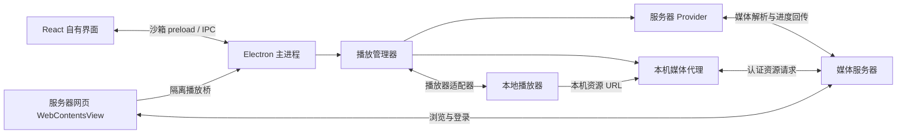
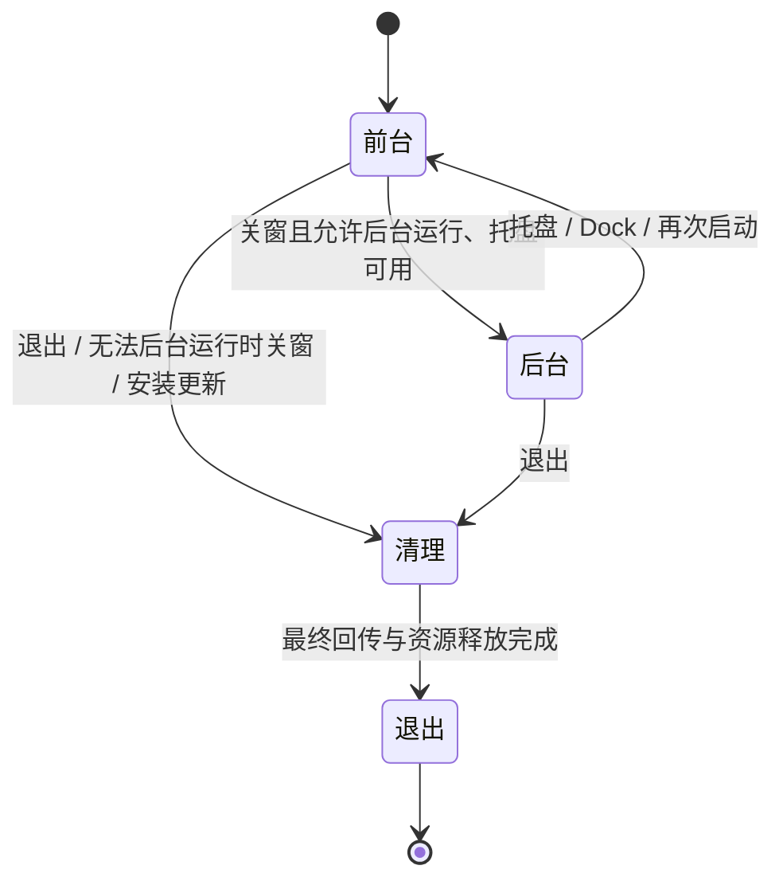

# Freebo 架构

Freebo 保留媒体服务器的网页浏览与登录体验，将视频播放交给本地播放器，并把观看进度同步回服务器。媒体接入支持 Emby、Jellyfin 和 Plex；服务器发现、媒体库管理和转码由服务器负责。通用 Web Service 可保存 HTTP(S) 地址并在应用内打开网页。

本文件说明当前架构与关键设计决策。开发、集成测试和发布步骤见 [开发流程](development.md)，视觉与交互规范见 [界面设计](design.md)。

自有界面的视觉主题注册、设置与边界见 [视觉主题](themes.md)。

## 整体结构

React 提供 Freebo 自身的界面，服务器网页由独立的 `WebContentsView` 承载，保留服务器原有功能。播放控制和服务器选择使用原生子窗口，避免被位于 React 页面上方的网页视图遮挡。

主进程协调原生窗口、服务器会话和播放资源。自有界面与远端网页使用不同的预加载接口，各自只能调用所需能力。

## 源码与资源归属

渲染端页面入口位于 `src/pages/`，组件按 `servers/`、`players/`、`playback/`、`settings/`、`setup/` 和 `browser/` 归档；跨功能组件位于 `src/components/shared/`，shadcn 基础组件保留在 `src/components/ui/`。渲染组件测试按相同功能放在 `tests/renderer/` 下。

`electron/` 保留主进程、Provider、播放器与原生窗口边界，跨进程类型和语义键位于 `src/shared/`。目录调整不改变 IPC 接口和用户数据布局。

集成图标位于 `public/integrations/servers/` 和 `public/integrations/players/`，来源见 [集成图标](integration-icons.md)。应用截图与品牌配图分别放在 `docs/assets/app/` 和 `docs/assets/brand/`。

品牌主稿与生成素材保留在 `assets/brand/freebo/`，`public/` 与 `resources/` 保存渲染和原生打包所需的运行副本，生成规则见 [品牌规范](brand/README.md)。相关生成与验证脚本集中于 `scripts/brand/`；媒体服务器诊断工具位于 `scripts/diagnostics/`，集成测试工具位于 `scripts/integration/`。开发、构建与联调的命令入口保留在 `scripts/` 根目录。

## 状态与导航

持久设置、网页登录会话和播放会话由主进程拥有。每个渲染窗口使用 TanStack Query 接收初始快照、IPC 推送及操作结果；递增的 `revision` 防止旧结果覆盖新状态，不通过轮询或自动重试反复执行 IPC 操作。

TanStack Router 管理页面位置，使用 memory history 保持 `file://` 入口稳定。路由切换同时协调原生网页视图；不可取消的原生导航按顺序执行，防止较早的请求覆盖后续跳转。

网页工具栏提供普通重新加载和忽略缓存的强制刷新；两者通过 `app:navigate` 操作当前原生网页视图，并共用加载中与错误恢复状态。

「设置 → 统计」由 React 路由承载 `web/统计页面.html`，构建时将该页面纳入 `dist`。统计 iframe 在切换选项卡时保持挂载，保留页面操作状态。页面通过受限的 `postMessage` 桥调用主窗口预加载 API 的读取、同步、设置及导入导出方法，再由 Electron 主进程读取 Jellyfin 媒体与观看状态及 Playback Reporting 播放记录。手动完整同步由主进程后台运行，页面通过同步状态与完成事件读取结果，无需等待单次请求完成。打开应用及 Jellyfin 网页登录后执行增量同步；主进程低频检查 Jellyfin 播放会话，在播放停止并等待记录写入后同步，统计页打开时约每 60 秒检查一次，后台另有周期增量检查以补齐其他客户端及程序关闭期间的记录。Playback Reporting 接口不可用时，本机服务按端口所属 Jellyfin 进程和配置来源定位数据库；用户可按服务指定手动路径，路径记录在用户数据目录。结果按服务器和用户保存在用户数据目录的 `watch-statistics/<serverId>-<userId>.json`，页面打开时可复用本地结果。导出使用单个版本化 JSON 文件，导入替换前备份现有快照；新设备登录后可将暂存记录绑定到当前 Jellyfin 用户。

同步快照还保存 Jellyfin `Views` 返回的媒体库 ID 与名称，包括空库。用户修正单独存于同目录的 `.corrections.json` 文件，按服务器及用户隔离；原始播放记录和媒体归属保持不变。展示时按单条播放记录修正、同一 ItemId 的记忆规则、同步结果、未匹配的顺序确定媒体库。作品规则只关联 Jellyfin ItemId，不按标题跨作品推断；历史补录仅接受作品规则。剧集清单展示原始媒体库信息，观看记录及其时长分布使用修正后的归属；单次记录修正不会改变整部剧集的媒体信息。同步与设置写入不覆盖独立修正文件。导出文件版本 2 包含档案及媒体库修正，版本 1 仍可导入；暂存用户绑定会合并档案与修正。

累计时长由去重的有效实播及没有重复覆盖的历史估算组成。首次建档时，已标记 Played 的电影和具体单集各建立一次历史确认，不使用 PlayCount 推算重温；没有实播的作品按片长建立一次估算，并保存固定基线。后来同步到基线之前的旧记录不与该估算重复计时，基线之后的新实播继续累计。Jellyfin 取消或恢复 Played 不改变确认次数。新的一刷候选来自首次 Played，重温候选来自上次确认后累计达到默认 10 分钟的有效新实播；用户确认、稍后、忽略和撤销均保存到快照。手动补记可按电影或电视剧的系列、季、单集设置总确认次数，并选择仅增加次数或增加片长估算。时间不可靠的历史确认及估算只进入全部时间统计；日历、时段和观影活动只使用实播记录。电影部次与剧集集次按确认计数，刷次分类互斥；导演的作品数量按不同媒体项目去重。删除的作品保留元数据和原媒体库，重新入库仅按明确的提供商标识或系列身份加季集号重映射。完整同步保留已有档案和修正，重复读取同一播放记录使用稳定记录 ID 去重。

表单草稿、确认框等临时状态留在所属组件。React Context 只提供窗口运行时，不复制共享数据。跨进程错误传递语义键与参数，由当前界面的 i18next 实例翻译。

## 服务器与播放器扩展

服务器差异集中在 `electron/providers/`，通过两个接口接入：

- `MediaServerProvider` 管理服务器入口、连接测试、网页接管及播放请求校验。
- `PlaybackClient` 解析队列、准备媒体及回传观看进度。

`ProviderRegistry` 按服务器类型注册实现，Chromium 会话按 Provider 和服务器 ID 隔离。网页、API 和媒体请求复用对应会话及网页登录身份，避免额外登录和认证不一致。

通用 Web Service 不进入媒体 Provider；它使用按服务 ID 持久隔离的 Chromium 会话，不注入媒体预加载脚本，也不启用媒体代理、播放接管或进度回传。其入口保留 URL 的路径、查询和片段，网页可在视图内跳转到其他 HTTP(S) 来源。

Emby 与 Jellyfin 共用兼容的媒体解析底层，各自保留认证和网页适配；Plex 使用独立客户端，接入媒体服务器自身的网页与队列。仅接管本地视频播放，音乐、直播和远端播放继续由网页处理。

播放管理器使用统一的播放意图、队列和媒体类型，不依赖服务器 DTO。播放器通信由适配器封装；Windows 的 PotPlayer、MPC 系列通过本地 C# 桥通信，并按播放进程隔离会话。新增服务器或播放器只扩展对应接口，共用播放生命周期。

Linux 的 [Cine（GTK）](https://github.com/diegopvlk/Cine/blob/v1.8.6/src/main.py) 使用 URL 打开接口，不接受 mpv 命令行参数或 JSON IPC。Freebo 单独识别 `cine`，以 `--new-window` 和当前视频的本机代理 URL 启动；仅打开当前视频，不提供 Freebo 续播、连播、轨道选择或进度回传。交接后状态为 `external`，界面提示在 Cine 中操作，不显示不可用的控制或虚构的播放进度。Freebo 保持媒体代理可用；Cine 可能将请求交给已有实例，其进程不由 Freebo 终止。

自定义播放器以独立配置保存名称、可执行文件、参数模板和可选的 `mpvIpc`；同一可执行文件可对应多个配置，重新扫描按配置 ID 保留。默认采用与 Cine 共用的 `external` 交接流程，不建立控制会话或回传观看记录。启用 mpv IPC 时进入现有 `PlayerSession`，自动注入每次会话的连接、续播与轨道等参数，通过实际状态驱动队列和回传；共享的参数校验阻止模板覆盖受控选项。自定义启动器退出后以 IPC 连接判定会话结束，连接失败保留错误，不降级为交接。模板替换后按参数数组直接启动程序，不经过 shell；macOS 应用包通过 `CFBundleExecutable` 定位实际可执行文件。添加／编辑由独立路由和表单草稿管理，保存结果归主进程设置存储。配置方法见 [自定义播放器](development.md#自定义播放器)。

播放器列表可移除每个已配置路径，不卸载播放器或停止现有播放。移除默认项时选用剩余的第一个播放器，没有剩余项则清空默认设置；移除结果持久保存。重新扫描会重新发现仍安装在扫描位置的播放器。

## 播放流程

1. 网页预加载捕获播放意图，经主进程校验后交给 Provider，沿用当前登录身份解析队列、续播点和轨道。
2. 播放管理器协调媒体代理与播放器适配器，将本机资源 URL 交给播放器。控制通道连接成功与媒体加载完成分别判断，取得有效位置和时长后才报告播放开始。
3. 播放器状态驱动开始、暂停、跳转和停止回传。请求按会话串行执行，旧会话的异步结果不能覆盖新会话；停止前读取最终位置，成功回传后再核对服务器保存的记录。记录核对失败不重复发送已经成功的停止请求。

队列切换、连续播放和轨道匹配由播放管理器统一处理，服务器协议留在 Provider 内，播放器能力差异留在适配器内。

## 信任边界与持久化

### 网页与凭据

远端网页禁用 Node.js，并启用 sandbox、context isolation 和 web security。播放桥仅接受当前服务器主框架的请求；认证地址及媒体、字幕资源必须属于注册服务器的来源与反向代理子路径。

媒体代理保留上游认证信息，播放器只获得本机不透明 URL，避免令牌进入播放器命令行或广播状态。系统目录和外部链接操作也由主进程限定目标，不接受渲染端任意路径或链接。

`CredentialStore` 使用 Electron safeStorage 加密保存账号密码，绑定服务器 ID、Provider 和完整注册地址。凭据不进入设置、全局状态或诊断；自动填充由通过来源与导航校验的隔离预加载完成，登录由用户提交。加密不可用时禁用保存，不降级为明文。

### 本地数据与诊断

用户数据目录分别保存设置、窗口状态、加密凭据及浏览器会话，避免不同生命周期的数据互相干扰。设置写入串行执行并原子替换；窗口状态独立保存，在恢复时约束到当前显示器范围。

配置读取忽略未知字段并补齐常规缺省值；读取、解析或校验失败时记录诊断，重置为默认配置继续启动。重置写回失败仍使用内存默认值，避免文件问题阻塞使用。当前开发阶段不执行版本迁移或旧目录搬迁。

诊断的复制与导出共用脱敏快照，排除凭据、服务器配置、媒体队列及本机路径。程序目录和数据目录只在本地诊断界面展示；反馈入口仅预填环境与复现模板，不自动上传日志。

## 托盘与退出

实例锁在初始化窗口和播放资源前申请，以实际用户数据目录为范围。同一目录只保留一个运行实例，再次启动恢复已有窗口；开发和集成测试可用独立目录分别运行。

关窗与退出分开处理：启用后台运行且托盘可用时，关窗仅隐藏窗口，网页、播放器和媒体代理继续运行；禁用后台运行或托盘不可用时，关窗执行清理后退出。

`AppLifecycle` 统一管理显式退出与更新安装：先停止播放并等待最终进度回传，再关闭媒体代理，最后允许销毁窗口。清理只执行一次，失败记录诊断后继续退出；安装启动失败且窗口仍存活时，恢复运行状态以便重试。

## 构建与升级

开发与打包共用主进程和预加载构建链，安装包及更新元数据由 electron-builder 生成。主进程通过 electron-updater 从固定的 GitHub Releases 获取正式版本，不接受渲染端指定更新来源。

自动更新适用于 Developer ID 签名的 macOS 安装版、Windows NSIS 安装版、Linux AppImage 和 deb，其余构建使用手动下载。

下载与安装分开：下载不会触发重启，关闭 `autoInstallOnAppQuit`，重启安装共用退出清理流程。macOS Squirrel 已暂存的更新仍可能在应用退出后的再次启动时安装。签名与发布操作见 [打包与发布](development.md#打包与发布)。

## 验证边界

当前实机验收以 macOS 开发版与 IINA 为主，已验证三种服务器的基本网页接管、播放和进度回传，以及单实例、后台运行和配置恢复。Compose 集成检查验证 Provider 与媒体代理协议，不能替代 Electron 和本地播放器验收。

Windows/Linux 原生行为、安装包完整运行与签名自动升级，以及 Plex 云端场景、复杂轨道、跨集和多 Part 的完整实机验收仍有缺口。验证方法统一见 [开发流程](development.md#媒体服务器集成测试)。

Cine 的启动参数、当前视频交接与不产生虚假回传的行为有回归测试；Linux/Cine 的实际视频播放仍未实机验收。

自定义播放器已在 macOS 通过 IINA 命令行验收通用 URL、标题和续播参数交接；可选 mpv IPC 已通过 IINA 参数转换启动器验收真实续播、暂停、跳转、停止及 Emby 持久进度回传。Windows/Linux 原生启动、其他播放器的参数接口和 IPC 仍需分别验收。
