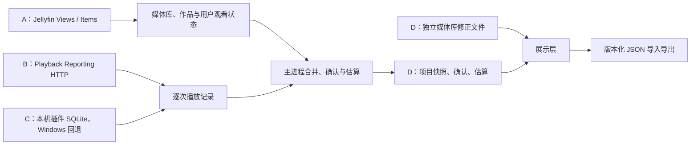

# 观影统计：数据契约与维护

本页是统计功能的权威专题。当前实现只接入 Jellyfin；操作入口见[开发流程](development.md#jellyfin-观影统计)。以下区分**当前代码事实**、**已验证环境**和**待验证或未来方案**。主进程同步和持久化见 [WatchStatisticsStore](../electron/core/watch-statistics.ts)，插件契约见[查询与解析](../electron/core/watch-statistics-playback-reporting.ts)，展示计算见[统计页面](../web/watch-statistics.js)，类型见[共享模型](../src/shared/watch-statistics.ts)。

## 数据链路与来源

「设置 → 统计」的 React 路由承载统计 iframe，页面通过受限 `postMessage` 桥与预加载 IPC 请求主进程；[统计页面](../web/watch-statistics.js)负责筛选与展示聚合，主进程负责读取和持久化。应用打开或 Jellyfin 网页登录后触发增量同步；播放停止并等待插件写入后再次同步，统计页打开时约每 60 秒检查一次，后台另有周期增量检查。手动完整同步在主进程后台运行，页面通过状态与完成事件刷新。

| 类别                    | 当前接口与必要字段                                                                                                                                                     | 类型、含义与边界                                                                                                                                                                                                                                                                                                                                              |
| ----------------------- | ---------------------------------------------------------------------------------------------------------------------------------------------------------------------- | ------------------------------------------------------------------------------------------------------------------------------------------------------------------------------------------------------------------------------------------------------------------------------------------------------------------------------------------------------------- |
| A 核心媒体库目录        | `Users/{userId}/Views` 的 `Items[].Id/Name`                                                                                                                            | ID 字符串、名称字符串；包括空库。用于归属目录，不是逐次观看证据。Jellyfin 10.11.11 中该路由仍可用但已标记废弃，委托 `UserViews?userId=`。                                                                                                                                                                                                                     |
| A 核心媒体及用户状态    | `Users/{userId}/Items` 分页或指定 `Ids`；`Id/Type/Name/ParentId/SeriesId/ParentIndexNumber/IndexNumber/RunTimeTicks/ProductionYear/Genres/People/ProviderIds/UserData` | ID、名称、类型是字符串，季集号、年份、ticks 是数字，genres 是字符串数组，People 是对象数组，ProviderIds 是字符串映射；ticks 为 100 ns，换算秒。`UserData.Played` 是布尔，`PlayCount` 是数字，`LastPlayedDate` 是时间文本，`PlaybackPositionTicks` 是数字。`PlayCount` 不推算重温次数。该旧路由在 Jellyfin 10.11.11 仍可用但已标记废弃，委托 `Items?userId=`。 |
| B 插件 HTTP             | Playback Reporting `POST user_usage_stats/submit_custom_query`，`CustomQueryString` 查询 `PlaybackActivity`，`ReplaceUserId: false`                                    | 响应有拼作 `colums` 的字符串列名数组、`results` 的二维数组和 `message` 字符串。数据库单元格经插件序列化为字符串，Freebo 显式将 `PlayDuration` 转成数字。插件接口需要管理员权限。                                                                                                                                                                              |
| C 本机 SQLite           | `System/Info.ProgramDataPath` 辅助定位；Windows 本机 `playback_reporting.db` 的 `PlaybackActivity`                                                                     | B 失败后本机只读查询九列：`DateCreated` 为 DATETIME，经 SQL 转 TEXT；`UserId/ItemId/ItemType/ItemName/ClientName/DeviceName/PlaybackMethod` 为 TEXT，`PlayDuration` 为 INT。手动路径及 System/Info 候选会先于进程核实，因此仅自动进程候选可称为端口归属核实。                                                                                                 |
| D Freebo 派生与用户资产 | `WatchStatisticsSnapshot`、`WatchConfirmation`、`WatchBackfill`、`corrections`                                                                                         | `records[].durationSec`、估算时长与运行时长为秒数；`startAt`、`baselineAt`、`confirmedAt` 为时间字符串；确认 ID、作品 ID、记录 ID 为字符串；修正是记录或作品 ID 到媒体库 ID 的字符串映射。它们不是上游原始字段。                                                                                                                                              |

上述 A 类旧路由的废弃标记与委托关系见 Jellyfin [ItemsController](https://github.com/jellyfin/jellyfin/blob/v10.11.11/Jellyfin.Api/Controllers/ItemsController.cs) 和 [UserViewsController](https://github.com/jellyfin/jellyfin/blob/v10.11.11/Jellyfin.Api/Controllers/UserViewsController.cs)；后续应评估改用新路由，不能把当前接口写成已失效。B/C 的权限、响应及表结构见插件 v17 [控制器](https://github.com/jellyfin/jellyfin-plugin-playbackreporting/blob/v17/Jellyfin.Plugin.PlaybackReporting/Api/PlaybackReportingActivityController.cs)和[仓库](https://github.com/jellyfin/jellyfin-plugin-playbackreporting/blob/v17/Jellyfin.Plugin.PlaybackReporting/Data/ActivityRepository.cs)。插件的时长来自未暂停的墙钟时间累计，详见 [PlaybackTracker](https://github.com/jellyfin/jellyfin-plugin-playbackreporting/blob/v17/Jellyfin.Plugin.PlaybackReporting/Data/PlaybackTracker.cs)；因此跳转、异常结束等情况下不应宣称它精确等于实际观看的不同画面长度。插件的按日 `GetItems` 会把时间格式化为不含秒和完整日期的显示文本，不能无损替换当前原始记录与 ID；聚合报表也不等于逐次历史。

当前 `Items` 全量扫描按媒体库递归分页（每页最多 500），启用 `EnableUserData`，限制 Movie/Series/Season/Episode，并请求 Genres/People/ParentId/ProviderIds；这些参数符合已核接口，缺省可选字段由代码兜底，属于合理的当前实现，应保留。

## 本地资产与身份

媒体目录通常可从服务器重取；插件历史过期或清理后，原始逐次记录可能无法重取；本地确认、估算、修正和操作历史无法从服务器重建。备份必须包含快照、独立修正与用户导出。

快照位于用户数据目录 `watch-statistics/<serverId>-<normalizedUserId>.json`，包含媒体、原始记录、估算 `backfill`、确认 `confirmations`、候选 `candidates`、已应用操作 ID、设置、媒体库目录及增量游标。独立的 `<快照路径>.corrections.json` 保存单次记录与作品的媒体库修正；`playback-reporting-paths.json` 保存按服务指定的数据库路径。它们及用户导出的版本 2 JSON 都是用户资产，不能因全量扫描、设置写入、升级或清理缓存而丢弃。导入支持版本 1、2；替换快照及已有修正前会留时间戳备份。暂存档案绑定用户时合并档案及修正。

Jellyfin ID 去掉连字符并转小写；文件按服务器 ID 与用户 ID 隔离。逐次记录 ID 由规范化用户 ID、作品 ID、原始 `DateCreated`、客户端名和设备名组成；`sourceKey` 保留后四者。改变字段、拼接、日期标准化或身份范围会影响去重、修正键、候选证据及导入后的继续同步，须先设计旧档案兼容。当前无法区分同作品、同时间、同客户端和同设备的两条真实记录。SQLite 有 `rowid`，但当前查询未使用它，也不能假定它跨数据库重建稳定。

插件 `DateCreated` 可能不带时区偏移；当前代码把它按**运行 Freebo 的本机时区**解析为 ISO 时间，原始文本另存于 `rawDate`。服务与客户端时区不同时可能偏移；勿未经数据迁移改变解释方式。增量同步按快照 `cursor` 回看七天的插件记录，合并时按稳定 ID 去重；完整同步保留既有档案、确认和修正。超过回看窗口才写入或更正的旧记录需要完整同步核查。当前解析要求完整九列和合法行，仅识别插件 v17 的精确空结果消息配空列、空行；畸形响应走本机数据库回退，不能当空历史。

[路径定位器](../electron/core/watch-statistics-path.ts)先限定本机地址和 Windows，然后依次尝试保存的手动路径、`System/Info.ProgramDataPath`、监听端口所属 Jellyfin 进程的 `--datadir`/`-d`、Freebo 进程可见的 `JELLYFIN_DATA_DIR`、注册表 `DataFolder`、`ProgramData`、`LOCALAPPDATA`、已保存的自动路径。各候选均验证文件名与九列。手动路径和 System/Info 候选在进程核实之前；其余环境及系统目录候选也不能证明文件一定属于该进程。代理、容器、多实例和路径重用时必须人工核对。

完整扫描中，删除的作品保留旧元数据及原媒体库。重新入库仅在明确且唯一的 TMDb/IMDb/TVDb 类型标识匹配时重映射非单集作品；单集依已匹配的系列及季集号重映射。标题不能作为跨作品身份。修正展示优先级是单次记录、同 ItemId 作品规则、同步归属、未匹配；历史补录只用作品规则，单次修正不改原始作品元数据。

### 维护审计结论

本次已修复：[插件解析](../electron/core/watch-statistics-playback-reporting.ts)集中九列、SQL 与 HTTP 响应校验，[路径验证](../electron/core/watch-statistics-path.ts)由少量列改为九列。记录 ID、时间算法与持久格式未变。以下是已证实但本次未改、潜在风险或保留边界；性能项是风险，尚非已发生故障。

| 优先级 | 状态         | 结论与处理边界                                                                                                                                                                                                         |
| ------ | ------------ | ---------------------------------------------------------------------------------------------------------------------------------------------------------------------------------------------------------------------- |
| 高     | 潜在性能风险 | [插件查询](../electron/core/watch-statistics-playback-reporting.ts)无分页或 LIMIT，当前 SQL 一次取回历史；大库响应、锁等待与内存风险需测量。未来分批须有稳定边界并处理同秒记录及后来更正，不能直接按 OFFSET 假设稳定。 |
| 中     | 当前保留     | 空插件结果与旧快照合并不会删去旧播放记录，但会推进以客户端当前时间写入的游标；首次空结果会产生零实播档案。需按接口原始响应判断空数据是否可信。                                                                         |
| 中     | 当前保留     | 当前查询未使用 SQLite rowid；同作品、同时间、同客户端及设备的记录可能 ID 碰撞。改变 ID 必须先迁移修正与确认的证据键。                                                                                                  |
| 中     | 当前保留     | 七天回看不能发现更晚才导入的旧历史，完整同步可以补齐。无时区日期在跨主机时区环境中可能偏移。                                                                                                                           |
| 待验证 | 环境边界     | 其他 Jellyfin/插件版本、远程普通用户权限、非 Windows 回退与跨设备导入均未在本专题所述实机组合下验收。                                                                                                                  |

## 统计不变量

近期范围（本年度、近 30 天、近 7 天、自定义近 N 天）的观看时长与“播放过的电影/单集”来自有效逐次实播；同一作品多条播放记录只在作品数中计一次，不能据此推断完整观看或刷次。范围从本地今天 00:00 回溯 N-1 个自然日，至当前时刻，沿用记录跨边界裁剪。自定义 N 是页面临时状态，不写入快照。“全部”继续用确认记录计算累计部次、集次与刷次分布，并纳入历史估算。确认时间仅表示用户操作时间，不作为历史观看发生日期；`Played` 与 `LastPlayedDate` 也不构成逐次历史。日历、活动与观影习惯仍只使用有实际时间的记录。详情中的观看次数编辑始终对全局确认档案操作，不将近期播放作品数写成确认次数。

完整扫描换源时，旧 ItemId 消失且唯一 TMDb/IMDb/TVDb 身份匹配则重映射；单集还要求系列匹配及相同季集号。旧条目与新条目同时存在时，仅对唯一的新重复条目沿用旧逻辑身份。已保存的播放记录 ID、确认及候选证据 ID 保持稳定，避免旧证据被当作新观看。缺少可靠身份或多个候选时保留旧资产，不按标题猜测。增量媒体请求仅容许单个已删除条目的 404；连接、权限和异常响应会中止同步，避免误报完整成功。

本次用隔离临时目录、合成媒体及播放响应调用实际 `refresh`，覆盖 A–D 连续完整与增量同步、E 新旧条目并存后的连续同步及新实播进入原确认的重看候选、F 无提供商 ID 时旧档案保留；确认及记录 ID 未重建、实播未重复计数。用网页实际 `bounds` 函数核对固定与自定义日期边界；用实际 `selectedRecords`、`renderOverview` 函数及合成数据核对近期《西部世界》拆段只计一集、《碧蓝之海》无近期实播不出现、“全部”仍计入两部确认作品，以及跨午夜与当前时刻裁剪。并执行类型检查、网页脚本语法检查及 diff 检查。没有连接用户的 Jellyfin 或真实档案运行这些场景。多个重复条目、身份字段缺失或不一致时仍需人工判定；既有快照中已经分裂且无法可靠对应的确认不能自动迁移。

- 累计时长 = 去重后的有效逐次时长 + 未被旧实播覆盖的历史估算。电影或具体单集首次出现 `Played=true` 且没有首次确认、待人工处理候选时，各自动建立一次历史确认。同步时已有的实播累计达到片长 90% 视为完整观看证据，不再估算；否则按完整片长建立一次估算并固定基线，当时已知的短实播仍单独计时。此后补到的基线前旧记录不与估算重复计时；基线后的新实播可继续累加。估算一旦建立不因后续实播消失。
- `Played` 只提供一刷线索，不提供观看次数，也不区分手动勾选与自动完成；取消或恢复它不撤销已确认次数。已有无证据且未处理的首次待确认候选可在同步时改为自动首次确认；带实播证据、稍后、忽略及来源不明的候选保留人工处理。新重温候选来自上次确认之后的有效新实播，默认累计达到 10 分钟待确认。用户确认、稍后、忽略、撤销及手动补记必须跨同步保留。
- 手动补记可设置电影或电视剧系列、季、单集总确认次数，可仅增加次数或附加片长估算。确认计数决定电影部次与剧集集次，刷次分类互斥；导演作品数量按媒体项目去重。
- 时间不可靠的历史确认与估算只进入全部时间汇总；日历、时段和观影活动只使用有时间的逐次实播。合并间隔、短片过滤与补全设置影响展示或候选计算，不得静默改写源记录。

## 已验证范围与潜在边界

用户提供的实机组合是 **Windows、Jellyfin 10.11.11、Playback Reporting 17.0.0.0**。这说明该环境曾可用，不能外推至其他插件版本、远端服务、其他操作系统或所有数据库安装路径。插件查询无分页；大量历史记录的响应体、超时及内存占用需要实测。查询权限、插件关闭或升级后的列名、列顺序、类型与 `message` 行为需按原始响应核对。本机数据库回退依赖 Windows 进程和路径定位，且不能替代远端历史读取。当前仓库没有统计专属 Vitest；普通媒体服务器集成检查不覆盖插件历史、导入导出和统计计数。

必要的现有检查入口是 `pnpm typecheck`、`pnpm test`（或定向 `pnpm exec vitest run <已有测试文件>`）及相关构建；本次文档不新增测试。`tests/helpers/` 的 IPC 桩不构成统计功能覆盖。诊断日志由应用内「设置 → 诊断」读取内存日志；当前源码未找到持久 `main.log` 写入，排查时不应假定用户数据目录有此文件。

## 升级与排查

1. 记录 Freebo、Jellyfin、Playback Reporting 版本、操作系统、服务是否本机及当前用户 ID；保留快照、独立修正文件和版本化导出，勿提交令牌、数据库、完整日志或用户观看数据。
2. 先确认同一用户的 `Views` 与分页 `Items` 返回目录和作品，再以管理员权限核查插件接口的 HTTP 状态、`colums/results/message`、九列名称及单元格类型。区分真实空结果、权限失败和响应结构变化；核对插件表与 `PlayDuration` 的语义。
3. 对比一条已知播放在插件原始 `DateCreated`、Freebo `rawDate/startAt`、作品 ID、用户 ID、秒数及客户端/设备中的值。跨时区先核对客户端与服务端本地时间；重复或缺失先核对稳定 ID、七天回看及是否做过完整同步。
4. API 不可用且是 Windows 本机服务时，检查进程、端口、配置来源和只读数据库路径；远端或非 Windows 不使用此回退。用完整同步核对媒体库与缺失作品，检查旧作品重映射是否具有唯一提供商标识。
5. 对比快照、修正文件、确认与估算基线和导出内容；先在隔离用户数据目录复现升级或导入，再记录哪一层发生变化。涉及统计契约的变更做必要的现有检查和手动验收，不以一般播放集成检查代替。
6. 成功后更新版本矩阵：Freebo 提交或版本、Jellyfin 与插件版本、操作系统、HTTP/本机数据库来源、是否完整同步、已验证场景与未验证范围。

## 未来统计源：能力研究，未实现

现有 `WatchMedia` 的名称、层级、片长等大部分形状可复用，但 GUID 去连字符、`Movie/Series/Episode` 枚举、提供商标识及 Played 语义均带 Jellyfin 假设。快照内容只存 `serverId`，用户隔离依靠外部文件名，内部没有 provider/user 命名空间。未来应在新来源适配层携带 `source + server + user` 上下文，声明逐次历史、有效实播秒数、时间可靠度和保留范围的能力；不要为此直接改写现有持久 ID。现有 `MediaServerProvider`/`PlaybackClient` 负责播放，不提供通用统计认证。[watchIdentity](../electron/main.ts)目前从 Jellyfin 网页 `ApiClient` 读取用户 ID 与令牌、校验服务 origin，统计请求沿用该会话的 fetch；新来源至少需要独立的身份获取和认证读取适配，再接入同一档案语义。

最小演进路线是先把 Jellyfin 数据读取从统计计算中独立出来，保留共享的确认、估算及去重规则；在首个真实新来源验证后，再按实际差异引入轻量接口，此时无需预设新的 Provider 框架。可按用户目标选择先验证 Emby 第三方插件契约，或先接入 Plex 原生观看状态与历史；Plex 原生历史缺少有效实播秒数，若需时长再评估 Tautulli。

可扩展的最小路线是保持 `WatchMedia`、逐次记录、确认及估算的内部含义，先为每个来源证明用户身份、作品身份、实际逐次时长、时间与增量游标的契约，再映射而非共用 Jellyfin 字段名。缺少可信逐次时长时只能提供明确标注的估算或观看状态，不能把片长冒充实播。

| 来源            | 已知能力                                                                                                                                                                                                                                                                              | 接入前必验                                                                                                                                                                                                                                                            |
| --------------- | ------------------------------------------------------------------------------------------------------------------------------------------------------------------------------------------------------------------------------------------------------------------------------------- | --------------------------------------------------------------------------------------------------------------------------------------------------------------------------------------------------------------------------------------------------------------------- |
| Plex 原生       | 官方 [PMS API](https://developer.plex.tv/pms/) 的 `/status/sessions/history/all` 支持分页及 `accountID/viewedAt` 过滤；含 `historyKey/ratingKey/librarySectionID/viewedAt/accountID/deviceID`。原生状态另有 `viewCount/lastViewedAt/viewOffset`，元数据分 Movie/show/season/episode。 | 历史接口未提供单次有效实播时长契约；不能用媒体 duration 代替。核对账户、媒体重建后 ratingKey、库归属与分页时间边界。                                                                                                                                                  |
| Plex + Tautulli | [Tautulli API](https://github.com/Tautulli/Tautulli/wiki/Tautulli-API-Reference#get_history) 的 `get_history` 支持 `start/length/grouping`，含 `row_id/reference_id/user_id/rating_key/started/stopped/paused_counter/play_duration`。                                                | 关闭分组后验证每行代表一次播放、时长及暂停秒数、用户与 Plex 项目关联、历史保留期。它是额外服务，不能视为 Plex 原生能力。                                                                                                                                              |
| Emby            | 官方 [UserItemDataDto](https://dev.emby.media/reference/RestAPI/PlaystateService/postUsersByUseridPlayeditemsById.html) 有 `Played/PlayCount/LastPlayedDate/PlaybackPositionTicks`；[Playback check-ins](https://dev.emby.media/doc/restapi/Playback-Check-ins.html) 是事件上报流程。 | 前者是聚合状态，后者不是完整历史读取。第三方 [Playback Reporting 插件](https://github.com/faush01/playback_reporting/blob/develop/playback_reporting/Api/UserActivityAPI.cs) 有管理员 API，但发行版本、字段、权限与实播时长必须实机核实；不能套用 Jellyfin v17 契约。 |

## 本次验证范围

直接执行 `./node_modules/.bin/tsc.cmd --noEmit` 通过；`pnpm typecheck` 因沙箱外 pnpm store symlink 的 EPERM 未启动。`git diff --check` 通过。一次性合成检查覆盖插件 v17 空结果、完整列零行、正常行及错误消息、缺列、短行、空时长的拒绝；隔离临时 SQLite 和两次 HTTP 增量同步验证九列/缺列、用户过滤、同 ID 更新时长只保留一条，以及确认依据、估算基线和修正保留。未新增测试文件；这些合成检查不等于真实 Jellyfin、插件、安装版或用户数据库实机验收。
